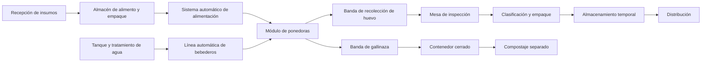

# Diseño físico preliminar

## 7.1 Módulo inicial

**Actualización (septiembre 2026):** el módulo inicial queda congelado como una **primera unidad financiable de 640 aves**. Esto no es una estimación propia: la cotización del proveedor (FamTECH — ver [registro de cotizaciones](../../evidence/quotations/README.md)) especifica textualmente "Advised chicken coop size: 17m×4m×4.2m / Total number: 640 birds" — nave de **17 × 4 × 4.2 m** (≈68 m² de huella), con jaula automatizada tipo H de **4 niveles, 5 sets** de **128 aves cada uno** (equivalencia "1 set = 1 grupo de jaula = 128 aves" confirmada por el proveedor por escrito el 2026-07-23). Esto sustituye la referencia anterior de una nave genérica de 18–24 m² con alojamiento en piso o jaula sin especificar, que correspondía a un sistema de menor densidad y ya no es una referencia válida una vez que existe una cotización real.

La subdivisión en subgrupos ya no es una decisión de diseño abierta: queda definida por la propia jaula tipo H (5 sets independientes, 4 niveles cada uno), lo que de forma natural permite:

* Aislar problemas.
* Comparar desempeño.
* Realizar mantenimiento parcial.
* Identificar consumo por subgrupo.
* Facilitar futuras pruebas de alimentación o manejo.

### Condiciones climáticas del sitio

El predio en San Francisco Acatepec se ubica en el altiplano poblano, a una altitud aproximada de 2,150 metros sobre el nivel del mar, con clima templado subhúmedo, temperaturas moderadas la mayor parte del año, noches frescas y una temporada de lluvias en verano que puede incluir granizadas. Estas condiciones deberán considerarse en el diseño:

* Menor riesgo de estrés calórico que en climas cálidos, lo que reduce la dependencia de enfriamiento evaporativo intensivo.
* Necesidad de protección contra descensos nocturnos de temperatura y heladas, particularmente en invierno.
* Estructura y techumbre resistentes a granizo.
* Buen drenaje pluvial durante la temporada de lluvias.
* Posible necesidad de calefacción auxiliar puntual, en lugar de un sistema de enfriamiento como prioridad principal.

**Nota técnica (revisión julio 2026):** la literatura de la industria (Bell & Weaver, *Commercial Chicken Meat and Egg Production*) no utiliza calefacción suplementaria para gallinas ponedoras adultas — ese recurso se reserva para la crianza de pollitas. Para clima frío en aves adultas, la estrategia estándar es **aislamiento térmico de la nave** combinado con **ventilación mínima reducida** (hasta 0.5 cfm/ave si existe sistema de enfriamiento tipo túnel para el verano), aprovechando el calor metabólico propio de las aves (~40–45 BTU/hora/ave). En consecuencia, la calefacción auxiliar debe tratarse como **contingencia secundaria para eventos extremos**, y la prioridad de diseño debe recaer en la especificación de aislamiento térmico de techo y paredes y en el control de ventilación mínima.

**Revisión septiembre 2026 — validación de R-20/R-14 (confirmado: se mantiene):** se revisaron íntegramente los tres libros de referencia del proyecto (*Commercial Chicken Meat and Egg Production*, *Poultry Production in Hot Climates*, y la guía de manejo Hy-Line W-80) más fuentes externas actuales para validar si R-20 techo / R-14 paredes sigue siendo apropiado.

*Fuente original de los valores (confirmado — Bell & Weaver, cap. 8, pp.154-157):*

| Tipo de clima | Δt (interior − exterior) | R techo (IP) | R paredes (IP) |
|---|---|---|---|
| Cálido | <30°F (17°C) | 9 | 6 |
| Medio | 30–50°F (17–28°C) | 12 | 8 |
| Frío | >50°F (28°C) | **20** | **14** |

*Cálculo de Δt para San Francisco Acatepec (recomendación técnica — no hay estación meteorológica propia en el predio, dato pendiente):* usando la temperatura interior objetivo de la línea genética Hy-Line W-80 en postura (**21°C**, guía de manejo p.9) y temperaturas exteriores regionales (Puebla/San Andrés Cholula, 2,150 msnm: mínima promedio de enero ≈7°C, heladas ocasionales hasta 0°C, extremos rurales estimados de -2 a -3°C), el Δt resultante (14–24°C) ubica al predio en la categoría **Media** de Bell & Weaver (17–28°C), no en "Frío" — lo que por sí solo apuntaría a R-12 techo / R-8 paredes como mínimo técnico.

*Por qué se mantiene R-20/R-14 de todos modos (decisión de diseño, margen de seguridad):* tres fuentes convergen en valores iguales o superiores a R-20/R-14 para naves de ponedoras sin calefacción suplementaria:
- **MWPS-7** (estándar ganadero de clima frío): R-19 techo / R-11 paredes como mínimo.
- **Estudio reciente revisado por pares** (nave multi-nivel de ponedoras, ventilación lateral, sin calefacción suplementaria) que logró 18.3–24.3°C interior en invierno (promedio 21.2°C, igual al objetivo Hy-Line) usando lana mineral de 150 mm en paredes (≈R-21 IP) y 200 mm en techo (≈R-28 IP) — más aislamiento que R-20/R-14, no menos.
- El propio Bell & Weaver, aplicado con el Δt calculado, da un mínimo (R-12/R-8) que ningún caso real revisado usa en la práctica para este tipo de sistema.

Dado que el costo incremental de aislar de más es bajo frente al riesgo de sub-aislar en un sitio a 2,150 msnm sin dato de estación propia, **R-20 techo / R-14 paredes se mantiene como valor de diseño**, ahora documentado como margen de seguridad validado por tres fuentes independientes, no como una estimación sin verificar.

*Aislamiento mínimo vs. recomendado (unidades IP y SI, 1 m²·°C/W = 5.678 ft²·°F·h/Btu):*

| | R (IP) | R (SI, m²·°C/W) | Base |
|---|---|---|---|
| Techo — mínimo por Δt regional | R-12 | 2.11 | Bell & Weaver, categoría Media |
| **Techo — recomendado (mantener)** | **R-20** | **3.52** | Bell & Weaver "Frío" + MWPS-7 + estudio reciente |
| Pared — mínimo por Δt regional | R-8 | 1.41 | Bell & Weaver, categoría Media |
| **Pared — recomendada (mantener)** | **R-14** | **2.46** | Bell & Weaver "Frío" + MWPS-7 + estudio reciente |

*Materiales y espesores aproximados (recomendación técnica, Bell & Weaver tabla 8-4):*

| Material | R por pulgada | Espesor para R-20 (techo) | Espesor para R-14 (pared) |
|---|---|---|---|
| Lana mineral / fibra de vidrio | R-3.3–3.7/in | ~13.5–15 cm | ~9.5–10.5 cm |
| Poliestireno expandido (EPS) | R-3.5/in | ~14.5 cm | ~10 cm |
| Poliestireno extruido (XPS) | R-5.0/in | ~10 cm | ~7 cm |
| Poliuretano rígido | R-6.6/in | ~7.5 cm | ~5.5 cm |

**Nuevo requisito — barrera de vapor (Bell & Weaver, cap. 8, p.155):** el aislante debe llevar barrera de vapor del lado interior/caliente (perm <0.5 — lámina de aluminio o polietileno), independientemente del valor R elegido. Con 640 aves produciendo ~7–8 kg/h de vapor de agua en clima frío (Tabla 8-2, escalada de la fuente), omitir la barrera de vapor puede condensar humedad dentro del aislamiento, perdiendo su valor R y corroyendo la estructura. Este requisito no estaba documentado antes y aplica sin importar el nivel de aislamiento final.

**Pendiente:** confirmar con datos reales (estación CONAGUA más cercana o registro propio de al menos un invierno en el predio) la temperatura mínima de diseño exacta del sitio — no para decidir si aislar (R-20/R-14 ya se mantiene), sino para el cálculo fino de carga térmica (Btu/h) y dimensionamiento de ventilación mínima de invierno en el proyecto ejecutivo final de obra civil. Sigue pendiente también solicitar al proveedor de la nave/jaula la especificación de aislamiento (valor R o equivalente) de su construcción propuesta, para verificar que cumple o supera estos valores.

**Tragaluces en cubierta (2026-09-17, decisión de diseño — ver especificación completa en [Automatización — Iluminación](./08-automatizacion.md#iluminación)):** se incorporan paneles de lámina traslúcida (fibra de vidrio o policarbonato, material local) en 2–5% del área de techo para aportar luz natural complementaria, con cortina interior opaca de blackout obligatoria durante las horas oscuras del fotoperiodo. Cada tragaluz es un punto débil frente al R-20 del resto de la cubierta (requiere detalle de sellado térmico y contra condensación en el marco, además de malla contra aves silvestres) — su área debe mantenerse mínima, no maximizarse. No corrige la variación de luz entre niveles de jaula (eso lo resuelve la tira LED por nivel del propio sistema tipo H) — es únicamente un complemento de ahorro energético.

### 7.1.1 Layout funcional recomendado (dentro de la nave 17×4×4.2 m)

**Revisión septiembre 2026:** se revisó la cotización FamTECH completa (partida por partida) y el hilo de correo íntegro con el proveedor para verificar si contenían datos de layout no reflejados aún en este documento. La cotización confirma que el sistema tiene equipo de cabecera en **ambos extremos** de la nave — "Front-end components" (hopper y motorreductor del skip-hoist feeder) y "Backend components and driver system" (unidad motriz de la máquina recolectora de huevo y de la banda de gallinaza) — dato **confirmado por la cotización** que no estaba explícito en la sección 7.1. El resto del layout detallado (footprint por set, dimensiones internas de jaula) sigue sin especificarse por el proveedor.

**Corte transversal (ancho, 4 m) — confirmado por FamTECH (2026-10-11), corrige la versión anterior:**

El arreglo "double-sided" es un bloque de jaula **espalda con espalda al centro** (las dos caras comparten una sola línea mecánica central: comedero, bebedero, banda de huevo, banda de gallinaza, riel del skip-hoist feeder), con **pasillos de circulación humana a los costados**, junto a cada pared — no un pasillo central entre dos bloques independientes como se dibujaba antes. FamTECH lo confirmó explícitamente ("If only one row is installed, with a walkway on each side, the total width is 4 m") y es consistente con una confirmación independiente anterior, de tres semanas antes y por un hilo distinto (iluminación): "Lights are located in **the aisles**, spaced 2.5 meters apart" (2026-09-20) — plural, lo que ya apuntaba a dos pasillos laterales, no uno central, aunque en su momento no se conectó con el layout. Ver [correspondencia](../../evidence/correspondence/2026-10-11_FamTECH_email_respuesta-civil-expansion-foundation.rtfd).

```
pared │ pasillo │   jaula 4 niv. + jaula 4 niv.    │ pasillo │ pared
      │ lateral │   (espalda con espalda, ~2.4m)   │ lateral │
      │ (~0.6m) │  línea central: comedero/bebedero/│ (~0.6m) │
      │         │  banda huevo/banda gallinaza/riel │         │
      └─────────┴────────────────────────────────┴─────────┴──────┘
                              ≈ 4.0 m total (3.6 m interior, descontando 2×0.2m pared)
```

Por qué tiene sentido mecánicamente: el riel del skip-hoist feeder (una sola máquina, origen fijo, confirmado) corre derecho por el centro y alimenta ambas caras al mismo tiempo sin desviarse — imposible de explicar limpiamente si las jaulas estuvieran contra las paredes con un vacío al centro. Y si el centro está ocupado por esa línea mecánica compartida, ahí no puede caminar una persona — de ahí los pasillos laterales. El pasillo lateral puede ser más angosto que el pasillo central que se presupuestaba (≈0.6 m vs. ≥1.0–1.2 m) porque ya no es la vía principal de tránsito: alimentación, agua, huevo y gallinaza son automáticos y corren por el centro; el pasillo lateral solo es para tareas humanas periódicas (inspección, mortalidad, mantenimiento).

**Por qué el diseño es "pasillo a cada lado" y no uno solo — expansión en filas paralelas:** FamTECH condicionó su respuesta a "if **only one row** is installed" (una sola fila) y, en la misma respuesta, habló de compartir equipo "between **the rows**" (entre las filas, plural) — es decir, el diseño está pensado para que, al crecer, se agregue una **fila paralela** junto a la existente, no solo para alargar la fila actual. Esto importa porque, si dos filas quedan una junto a otra, **el pasillo que las separa puede compartirse entre ambas** (una fila usa ese pasillo como su lado derecho, la vecina como su lado izquierdo) — con 4 pasillos independientes por cada fila nueva no sería así de eficiente en espacio. Esto es coherente con el criterio de "equipo compartido, consumible por fila" ya confirmado: cada fila nueva compra su propia cabecera (hopper, máquina de huevo) y jaula, pero la estructura civil (muros, pasillo) puede compartirse con la fila vecina. Para la escala objetivo del plan (≈5,120 aves ≈ 40 sets) esto no es urgente — cabe dentro de una sola fila (muy por debajo del límite de 90 sets/120 m) — pero es relevante para el trazo del predio a largo plazo: si en algún momento se agregan filas paralelas, conviene reservar el terreno contiguo a la nave actual (no solo el corredor longitudinal de Cabecera B) desde ahora.

**Planta (largo, 17 m):**

```
[Puerta/  [Cabecera A]   [Set1][Set2][Set3][Set4][Set5]   [Cabecera B]   [Puerta/
 alimento] hopper+motor                                    máq. recol.    empaque]
 acceso    reductor                                        huevo+gallinaza acceso
 1m (conf.) skip-hoist                                      1m (conf.)
          6 m (5 sets × 1.2 m, confirmado 2026-09-28)
```

**Confirmado por FamTECH (2026-09-28, ver [correspondencia](../../evidence/correspondence/2026-09-28_FamTECH_email_respuesta-lote1-expansion-layout.rtfd)):** el pasillo/espacio de circulación reservado en cada extremo es de **1 m** — menos que la recomendación interna de NidoSmart de ≥1.5 m (ver "Recomendaciones" abajo). Cada set (stack de 4 niveles) ocupa **1.2 m** a lo largo de la nave, no los ~2.0–2.2 m estimados antes — el "cage body" es de 1.2×1.2 m (mismo dato ya confirmado para la huella por nivel, ver "Densidad de jaula" abajo), y ese mismo valor es el que se repite a lo largo de la fila. FamTECH aclaró explícitamente que **no debe calcularse la capacidad dividiendo 17 m entre 5 sets**, porque esos 17 m incluyen además el equipo de cabecera (hopper/motorreductor en un extremo, máquina recolectora de huevo/unidad motriz en el otro) — equipo que **se compra una sola vez por fila**, sin importar si la fila tiene 5 o 90 sets.

- **Extremo A (alimentación):** hopper, motorreductor del skip-hoist feeder, acceso desde almacén de alimento.
- **Extremo B (huevo/gallinaza):** cuerpo de la máquina recolectora de huevo, unidad motriz de bandas, salida hacia mesa de inspección/empaque y hacia banda/contenedor de gallinaza.
- **Cuarto técnico** (PLC, UPS, tablero): adosado al exterior junto al extremo con mayor carga eléctrica, fuera de los 68 m² de la nave.
- **Filtro sanitario:** en el único acceso peatonal al predio, antes de llegar a cualquiera de las dos puertas de la nave.
- **Gallinaza:** salida por el extremo B hacia zona de compostaje separada, a favor del viento dominante (pendiente de estudio de sitio).

**Dirección de crecimiento — decidido (2026-09-23):** para preservar la expansión lineal de [DEC-014](../governance/registro-de-decisiones.md#dec-014--expansión-lineal-de-la-nave-con-equipo-de-alimentaciónrecolección-compartido-hasta-el-techo-declarado-por-el-proveedor) sin tener que reubicar infraestructura ya construida, **Cabecera A (alimentación) queda fija**: el filtro sanitario, el acceso principal y el cuarto técnico se sitúan de forma permanente en este extremo. El crecimiento futuro (segunda unidad de 1,280 aves, y hacia el techo declarado por el proveedor) se realiza agregando sets junto a **Cabecera B (huevo/gallinaza)**, que se desplaza hacia afuera conforme la nave se alarga. Esto es consistente con la operación física confirmada del skip-hoist feeder (recorrido desde un hopper de origen fijo, hasta 100 m — ver [registro de cotizaciones](../../evidence/quotations/README.md)). Consecuencia directa: la vialidad principal y el trazo del cerco perimetral deben dejar el corredor de crecimiento libre **del lado de Cabecera B**, no del lado de Cabecera A. Ver [Modelo modular de crecimiento — 6.4](./06-crecimiento-modular.md#64-requisitos-de-diseño-de-la-primera-nave-para-preservar-la-expansión-septiembre-2026).

**Límite de longitud y requisitos de cimentación por fases — confirmado (2026-10-11):** FamTECH, ya con su ingeniero civil, fijó el techo práctico de esta nave en **120 m** ("We do not recommend a poultry-house length exceeding 120 m. If a longer length is required, an additional unit should be added accordingly") — más allá de ese punto, el crecimiento deja de ser "agregar sets a esta misma nave" y pasa a ser una unidad adicional completa. También confirmaron **juntas de expansión constructivas cada ≈6 m** (validar la cifra exacta con el ingeniero civil local) y que **la cimentación de cada fase debe quedar al mismo nivel** que las fases anteriores, para evitar diferencias de altura entre tramos que afecten la operación. Ver [correspondencia](../../evidence/correspondence/2026-10-11_FamTECH_email_respuesta-civil-expansion-foundation.rtfd).

**Dimensiones mínimas estimadas (no confirmadas — recomendación técnica derivada de catálogo público del mismo proveedor y referencias de industria, no de la cotización específica de este pedido):**

| Eje | Mínimo estimado | Base |
|---|---|---|
| Ancho | ≈3.6–3.8 m | 2×(pared 0.2 m + jaula ~0.9–1.1 m) + pasillo mínimo 0.8 m |
| Alto (interior útil) | ≈3.8–4.2 m | stack de 4 niveles (~3.2–3.4 m, ref. catálogo/industria) + ≥0.6–0.8 m de gálibo para riel de alimentación, máquina de huevo y luminarias |
| Largo | ≈14–15 m | 5 sets (~2.0–2.2 m c/u, estimado) + 2 cabeceras de máquina (~1.5–2 m c/u) |

**Conclusión sobre 17×4×4.2 m — altura resuelta (2026-09-28):** el punto que se marcaba como prioridad #1 (si el stack real agotaba el margen de los 4.2 m) queda resuelto: FamTECH confirmó por escrito que **4.2 m es la altura libre interior de la nave** (no la altura total de la estructura descontando cubierta/pendiente de techo), que su equipo técnico revisó y confirmó el diseño 17×4×4.2 m, y que el espacio de circulación en ambas cabeceras ya está reservado dentro de esa envolvente (1 m por lado, ver arriba). Esto elimina la incertidumbre que motivaba no fijar todavía el tipo estructural por temor a que la altura resultara insuficiente. Sigue pendiente únicamente el margen de techo sobre el nivel superior de jaula para cubierta/aislamiento (ver recomendación abajo) — un pendiente menor, ya no bloqueante.

**Recomendaciones dentro de la envolvente confirmada:**

- Pasillos laterales ≈0.6 m por lado (confirmados por FamTECH, no un pasillo central) — suficientes para tareas humanas periódicas (inspección, mortalidad, mantenimiento), ya que la operación diaria (alimentación, agua, huevo, gallinaza) es automática y corre por la línea central. Verificar en comisionamiento que 0.6 m es cómodo para cargar una carretilla de mortalidad o un carrito de limpieza; si resulta demasiado angosto, la única forma de ganarlo es reduciendo el fondo de jaula (no negociable, ya cotizado) o ampliando el ancho total de la nave más allá de 4 m.
- **Espacio en cada cabecera:** FamTECH reserva 1 m por lado dentro de los 17 m — menos que la recomendación interna previa de ≥1.5 m. Decisión pendiente de NidoSmart: aceptar 1 m (ya confirmado y sin costo adicional) o solicitar construir la nave con un poco más de longitud para ganar circulación extra en las cabeceras.
- Exigir al proveedor un margen de techo ≥0.5–0.8 m sobre el nivel superior de jaula antes de fijar tipo estructural y cubierta.

**Pendientes de layout a resolver con FamTECH (actualizado 2026-09-28, ver [correspondencia](../../evidence/correspondence/2026-09-28_FamTECH_email_respuesta-lote1-expansion-layout.rtfd) y [registro de cotizaciones](../../evidence/quotations/README.md#lo-que-no-especifica-todavía-el-proveedor-pendiente-real-no-resuelto-por-este-hilo)):**

1. ~~Altura libre real requerida por el sistema completo instalado.~~ — **Resuelto:** 4.2 m es la altura libre interior confirmada por FamTECH; su equipo técnico ya validó el diseño completo (stack + riel + máquina de huevo) contra esa altura.
2. Footprint longitudinal real de cada set — **parcialmente resuelto:** el cuerpo de jaula (1.2×1.2 m) es el valor que se repite por set a lo largo de la fila, y el espacio de circulación en cada cabecera es de 1 m (confirmado). Sigue pendiente el footprint propio del equipo de cabecera (hopper/motorreductor en un extremo; máquina recolectora de huevo/unidad motriz en el otro) — FamTECH solo confirmó que es equipo único por fila, no sus dimensiones exactas.
3. ~~Footprint transversal del arreglo "double-sided" (profundidad de jaula + pasillo) para confirmar los 4 m de ancho.~~ — **Resuelto (2026-10-11):** el arreglo es un bloque de jaula espalda con espalda al centro (línea mecánica compartida: comedero, bebedero, bandas, riel del feeder), con pasillos de circulación humana a los costados (≈0.6 m por lado) — no el pasillo central único que se dibujaba antes. Corrige el diagrama de corte transversal de arriba. Razonamiento y corroboración (confirmación independiente de "the aisles" en plural desde el hilo de iluminación, 2026-09-20) en el corte transversal arriba.

### Densidad de jaula (pendiente de verificación con proveedor)

Los estándares de la industria para gallinas ponedoras en jaula (Bell & Weaver, tabla 52-2) sitúan el espacio mínimo recomendado entre **60 y 70 pulgadas² por ave (387–452 cm²)**, con un rango mundial de 48–72 in² (310–465 cm²) y el estándar europeo en 70 in² (450 cm²). La cotización vigente del proveedor (FamTECH, ver [registro de cotizaciones](../../evidence/quotations/README.md)) confirma la nave completa (17×4×4.2 m, 5 sets tipo H, 4 niveles, 640 aves) pero no incluye las dimensiones exactas de cada jaula individual (ancho, fondo y alto por nivel). NidoSmart redactó estas preguntas específicas el 2026-07-25, pero — según el hilo de correo completo revisado — no llegaron a enviarse al proveedor.

**Resuelto (2026-09-20) — respuesta directa de FamTECH:** dimensiones por nivel **1.2 m × 1.2 m** (1.44 m² de huella por nivel), **32 aves por nivel** (consistente con 128 aves/set ÷ 4 niveles ya confirmado), y espacio de **450 cm² por ave** — calculado por FamTECH como 14,400 cm² ÷ 32 aves = 450 cm²/ave, cifra que coincide exactamente con el cálculo propio a partir de las dimensiones dadas. **450 cm²/ave cumple el estándar europeo (70 in²) y está en el extremo superior del rango de industria (387–452 cm²)** — la densidad de jaula queda confirmada como adecuada, sin necesidad de renegociar el diseño. Sigue **pendiente**: la altura por nivel (dato no incluido en esta respuesta, necesario junto con el stack completo para verificar el margen de techo de [7.1.1](#711-layout-funcional-recomendado-dentro-de-la-nave-17×4×42-m)), y el aislamiento térmico de la nave.

**Uso adicional de este mismo dato (confirmado 2026-09-28):** FamTECH aclaró que el mismo cuerpo de jaula de 1.2×1.2 m es también el valor que se repite longitudinalmente por cada set agregado a la fila (ver [7.1.1](#711-layout-funcional-recomendado-dentro-de-la-nave-17×4×42-m) y [Modelo modular de crecimiento — 6.2](./06-crecimiento-modular.md#62-escala-recomendada)) — corrige la estimación anterior de ~3.4 m/set, que dividía incorrectamente los 17 m totales (que incluyen equipo de cabecera) entre 5 sets.

**Espacio de comedero por ave — resuelto (2026-09-28):** FamTECH confirmó que cada jaula aloja 32 aves con dos comederos que suman 2.4 m de longitud, equivalente a **≈7.5 cm/ave**. Comparado contra la guía de manejo de la línea genética específica del proyecto (Hy-Line W-80, `knowledge-base/genetics/hy-line-w80.pdf`: **7–9 cm/ave** en la etapa de producción, 20+ semanas) — más precisa que la referencia genérica de industria ya citada en [Automatización — Alimentación](./08-automatizacion.md#alimentación) (Bell & Weaver, 7.6–8.4 cm/ave mínimo) — el valor de FamTECH queda **dentro del rango específico de la línea, pero en el extremo bajo, sin margen adicional** (mismo patrón ya observado con la relación de níples por ave, 8 aves/níple, extremo superior de su rango). No se recomienda renegociar el diseño, pero si durante el comisionamiento se observa competencia por el comedero, no hay margen para compensarlo sin modificar la jaula ya cotizada.

## 7.2 Áreas generales del predio

El predio deberá considerar:

* Acceso controlado.
* Estacionamiento y recepción.
* Filtro sanitario.
* Cuarto técnico.
* Almacén de alimento.
* Área de empaque.
* Cámara o zona de almacenamiento temporal.
* Módulos de producción.
* Zona de gallinaza o compostaje.
* Área temporal para mortalidades.
* Vialidades internas.
* Espacio reservado para expansión.
* Barrera física y control de fauna.

### 7.2.1 Dimensionamiento preliminar de espacios de servicio (septiembre 2026)

**Objetivo:** estimar m² de trabajo para almacén de alimento, área de empaque y zona de almacenamiento temporal — pendiente crítico ya señalado en la [ficha técnica de la nave](../investment-project/05-ficha-tecnica-nave.md#estado-de-la-ficha-técnica) — sin esperar el estudio de sitio completo, aplicando el mismo margen de diseño para 1,280 aves ya usado en electricidad ([DEC-010](../governance/registro-de-decisiones.md#dec-010--dimensionamiento-de-servicios-compartidos-para-300-aves-desde-el-módulo-piloto)) y agua ([Arquitectura eléctrica/hidráulica — 9.2](./09-arquitectura-electrica-hidraulica-comunicaciones.md#92-sistema-hidráulico)). Es una estimación preliminar de trabajo para no bloquear el trazo del predio — no sustituye el estudio de sitio ni una cotización de obra civil.

**Almacén de alimento**

* Consumo de alimento (guía de manejo Hy-Line W-80, `knowledge-base/genetics/hy-line-w80.pdf`, Resumen de Estándares de Rendimiento): **104.8–108.4 g/día por ave** (19–100 semanas).
* 640 aves: ≈67.1–69.4 kg/día. Con margen para 1,280 aves: ≈134.1–138.8 kg/día.
* Reserva objetivo en sitio: 30 días — margen conservador por la logística rural del predio (decisión de diseño propia, no una norma citada).
* Volumen a 30 días: 640 aves ≈2,010–2,080 kg; 1,280 aves ≈4,020–4,170 kg.
* Densidad aproximada del alimento en costal (≈600 kg/m³, cifra genérica de mercado, no de Hy-Line/Bell & Weaver): 640 aves ≈3.4–3.5 m³; 1,280 aves ≈6.7–7.0 m³.
* A una altura útil de estiba de ≈1.75 m, el footprint de solo alimento es de apenas ≈2–4 m² a escala de 1,280 aves — insuficiente como área real de trabajo. Sumando pasillo de circulación, maniobra de costales/pallets y espacio para otros insumos (material de empaque, químicos de limpieza, refacciones), se recomienda un **almacén de ≈12–18 m²** como piso de diseño con margen para 1,280 aves.

**Área de empaque**

* Producción de huevo ya documentada ([Proyecto de inversión — 5](../investment-project/01-proyecto-de-inversion.md#5-operación-esperada-de-la-unidad-congelada)): ≈526–543 huevos/día (≈32 kg/día) a 640 aves; con margen para 1,280 aves, ≈1,052–1,086 huevos/día (≈64 kg/día).
* No existe en la bibliografía local (Hy-Line, Bell & Weaver) una referencia de m² por volumen para empaque manual/semi-manual a esta escala — la única referencia de la bibliografía (clasificadora industrial, Bell & Weaver cap. 50) aplica a ≈1,000,000 de aves y ya fue descartada (ver [Automatización — Recolección de huevo](./08-automatizacion.md#recolección-de-huevo)). Se propone una estimación general de práctica, no citada, sujeta a validar con el flujo real de cartoneo: mesa de inspección/candling, estación de llenado de cartones y estiba temporal de cajas antes de despacho — **≈8–12 m²** como piso de diseño funcional a esta escala.

**Cámara o zona de almacenamiento temporal**

* Con ≈32–64 kg/día de huevo y venta directa de ciclo corto (sin vehículo dedicado, ver [Vehículo de distribución](../investment-project/06-vehiculo-de-distribucion.md)), el volumen no justifica una cámara refrigerada dedicada a esta escala. **Recomendación: no reservar un espacio separado** — el almacenamiento temporal (anaqueles, 1–2 días de producción) se resuelve dentro del área de empaque ya dimensionada arriba. Revisar esta recomendación cuando el ciclo de venta real de la segunda unidad (1,280 aves) esté validado.

**Total preliminar de espacios de servicio (piso de diseño con margen para 1,280 aves):** ≈20–30 m² (almacén + empaque), sin cámara dedicada. Cifra de trabajo para avanzar el trazo del predio — se reemplaza por datos reales de layout una vez que se cuente con cotización de obra civil y con el flujo de empaque definitivo.

### 7.2.2 Drenaje y manejo de gallinaza (revisión septiembre 2026)

**Dos sistemas de drenaje separados, no uno solo:** el requisito genérico de "buen drenaje pluvial" no cubre el agua de lavado/desinfección de la nave, que por normativa (Manual de Buenas Prácticas Pecuarias en la Producción de Huevo para Plato, §8.5) no puede mezclarse con el pluvial ni descargarse a canales, ríos o arroyos — debe dirigirse a alcantarillado público con pre-tratamiento mínimo, o a un sistema de tratamiento propio si no hay alcantarillado disponible en el predio (ver pendiente en [Regulación y cumplimiento — 18.1](./19-regulacion-y-cumplimiento.md#181-trámites-específicos-para-san-francisco-acatepec-san-andrés-cholula-puebla)).

* **Drenaje pluvial:** canaletas de techo y pendiente del predio hacia fuera de las áreas de producción; sin cálculo de capacidad todavía (pendiente de ingeniero civil/DRO, ver [Ficha técnica](../../docs/investment-project/05-ficha-tecnica-nave.md)).
* **Drenaje sanitario (aguas residuales):** agua de lavado de caseta, tinacos, módulo sanitario y lavandería, con pre-tratamiento mínimo antes de su destino final; prohibida su descarga a cuerpos de agua superficiales.
* **Zona de gallinaza/compostaje:** debe protegerse con bordos (*berms*) que impidan que la lluvia arrastre lixiviados fuera del área, y la pila debe protegerse de la lluvia directa (Bell & Weaver, cap. 11-H).
* **Separaciones mínimas (pendientes de verificar contra el predio real, ver [Regulación y cumplimiento](./19-regulacion-y-cumplimiento.md)):** pozo de agua ↔ zona de gallinaza/compostaje ≥30 m (Bell & Weaver, tabla 43-15); cualquier fosa (p. ej. de mortalidad) ↔ cuerpo de agua superficial ≥20 m, y piso de la fosa ≥1.5 m sobre el nivel freático (Manual de Buenas Prácticas Pecuarias, §8.2).
* **Producción y manejo de gallinaza (cálculo propio a partir de Bell & Weaver, cap. 11-B):** ≈65–125 kg/día de gallinaza fresca para 640 aves (75–80% de humedad al salir de la nave). Objetivo de humedad en almacenamiento: <35% para minimizar reproducción de moscas. Antes de transportarse fuera del predio requiere tratamiento térmico de fermentación de al menos 48 h a ≥56°C, avalado por escrito por un MVZ (Manual de Buenas Prácticas Pecuarias, §8.4, cita NOM-024-ZOO-1995).

**Fosa de banda de gallinaza y elevador de descarga — nuevo requisito de obra civil (2026-10-13):** al preguntarle a FamTECH el punto y altura de descarga de la banda (para diseñar el contenedor cerrado), su ingeniero envió un plano de detalle que revela un requisito de piso no contemplado hasta ahora — no es un contenedor a nivel de piso, sino una estructura de dos partes:

1. **Fosa longitudinal bajo la banda:** construida de tabique, ≈750 mm de profundidad, corriendo bajo la banda de gallinaza a todo lo largo de la nave. El piso interior se inclina **0.6% hacia el centro desde ambos lados** (dirigiendo cualquier escurrimiento hacia la fosa) y el fondo de la fosa se inclina **0.5% hacia el extremo de descarga**.
2. **Elevador inclinado externo:** en el extremo de descarga (cabecera de gallinaza/huevo, fuera de la nave, a través de una puerta con dintel a 1.5 m), la banda sube por un elevador inclinado a **≈25°**, alcanzando **≈3 m de altura** en el punto de descarga al contenedor — sobre zapatas de concreto prefabricadas (≈1.2 m de base, ≈375 mm de profundidad).

Ver los planos de FamTECH: [corte de la fosa](../../evidence/quotations/2026-10-13_FamTECH_dibujo-descarga-gallinaza_1-corte-fosa.png), [corte longitudinal de la nave](../../evidence/quotations/2026-10-13_FamTECH_dibujo-descarga-gallinaza_2-corte-nave.png), [elevador inclinado](../../evidence/quotations/2026-10-13_FamTECH_dibujo-descarga-gallinaza_3-elevador-inclinado.png).

**Implicaciones:**

* El piso de la nave **no es plano** — es un requisito de diseño estructural (excavación, impermeabilización, muro de tabique) que debe incorporarse desde la cimentación, no agregarse después. Afecta directamente la partida de obra civil ([Presupuesto consolidado — 5.1](../../investment-project/07-presupuesto-consolidado-inversion-inicial.md#51-drenaje-aguas-residuales-y-manejo-de-gallinaza)), hoy estimada de forma genérica sin este detalle.
* El elevador inclinado y su cimentación de zapatas prefabricadas ocupan espacio **fuera** del footprint de 17×4 m de la nave, en el extremo de la cabecera de huevo/gallinaza — debe reservarse en el trazo del predio junto con el contenedor cerrado y la zona de compostaje (ver [§7.1.1](#711-layout-funcional-recomendado-dentro-de-la-nave-17×4×42-m)).
* Esta fosa de 750 mm es independiente de las pendientes de drenaje pluvial/sanitario ya descritas arriba — es un elemento estructural propio del sistema de gallinaza FamTECH, no parte del drenaje general del predio.

## 7.3 Flujo operativo



---

## Navegación

- [Índice general](./README.md)
- [Documento anterior: Modelo modular de crecimiento](./06-crecimiento-modular.md)
- [Documento siguiente: Sistema de automatización](./08-automatizacion.md)
